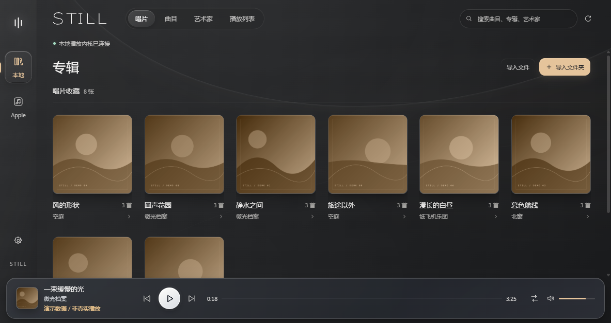
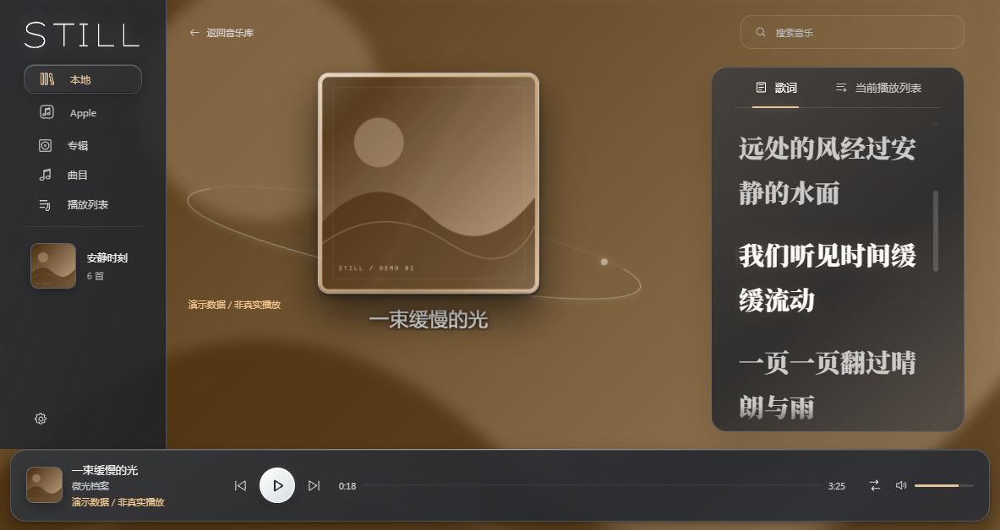

# STILL · 静室

STILL 是一款独立的 Windows 桌面音乐播放器。把自己的音乐收进安静的唱片库，在歌词与封面之间聆听；也可以通过 Apple Music 官方网页会话浏览和播放订阅内容。STILL 并非 foobar2000 官方产品，也未获得其作者背书。





> 界面预览拍摄于本次功能更新之前，使用自编曲名、歌词和原创示意封面；STILL 不附带音乐。[查看素材来源](docs/images/README.md)。

## 开始使用

1. 在 Windows 10 或更新版本的 x64 系统上，确认已安装 .NET Framework 4.8 或更新版本，从 [v1.1.0 Releases 页面](https://github.com/fask999/still-player/releases/tag/v1.1.0) 下载 `STILL-1.1.0-Setup-x64.exe` 并运行。安装时可选择程序目录；默认位置是 `%LOCALAPPDATA%\Programs\STILL`。安装和使用无需自行安装 Node.js、开发 SDK 或已有 foobar2000。
2. 首次打开 STILL，等待它在 `%LOCALAPPDATA%\STILL` 中自动准备独立播放内核和组件；界面会显示进度，也可稍后准备或在失败后重试。安装包随附未修改的官方 foobar2000 安装文件，不需要预先安装或复用已有的 foobar2000。
3. 打开 **音频与设置**，明确选择带设备名称的具体共享输出，避免使用 `Default` 或“主声音驱动程序”等模糊选项。这是播放本地音乐和 Apple Music 前都需要完成的步骤。
4. 选择 **导入文件** 或 **导入文件夹**，然后在唱片、曲目、艺术家或播放列表中选择音乐。

使用 Apple Music 时，系统还需安装 [Microsoft Edge WebView2 Runtime](https://developer.microsoft.com/microsoft-edge/webview2/)；随包的 SDK 文件不等于浏览器运行时。选择左侧 **Apple** 并按提示打开官方会话、自行登录。登录和浏览可在内核设置前进行，但播放前须完成上面的本地内核及具体共享输出设置。可用内容与播放能力取决于账户、订阅、地区和网页环境。详细步骤、设备设置和故障排查见 [用户指南](docs/public-user-guide.md)。

## 功能

- **本地音乐库**：按专辑、曲目和艺术家浏览，搜索音乐、创建播放列表，管理临时队列；可选择 CUE 文件导入其已核验曲目，原音频保持不变。
- **听音与歌词**：点击底部封面进入听音界面；显示可用的原文和译文，支持内嵌歌词、本地导入、在线查找、缓存和逐曲时间微调。
- **封面与桌面**：优先使用音频内嵌封面，也支持同目录封面和分层缓存；记住窗口位置，提供播放时防止系统睡眠、定时停止及 Windows 媒体键。
- **Apple Music 官方会话**：登录后可按实际可用能力浏览、搜索和播放。播放和曲库的可用性以官方会话返回的状态为准。
- **个性化**：调整光线与外观，或开启减少界面动效；常用播放、输出和诊断入口位于左下角的 **音频与设置**。

## 音频输出

本地音乐由 STILL 管理的 foobar2000 内核播放，默认使用系统共享输出。可在 **音频与设置** 中为本地播放选择可用设备；若设备提供 WASAPI 独占选项，可根据当前设备格式明确选择。独占是否实际可用取决于设备、驱动和当前占用情况；界面的配置读回不等于硬件实际格式或独占状态的测量。

本版 Apple Music 官方网页会话通过 Windows 系统输出，本地输出选择不会改变它的输出设备；如要通过 USB DAC 听 Apple Music，请在 Windows 中设置网页会话使用的设备。本版尚未提供 Apple 播放流的应用内精确设备选择或可验证的 WASAPI 独占，不承诺自动切换 DAC 采样率。

## 验证状态

在独立的 Windows 实机静音测试中，本地播放经 USB 共享输出推进约 36 秒。隔离索引识别了两首 CUE 曲目，主播放的队列、列表和来源保持一致。切换到时长 45 秒的第二首后，标题与播放进度正确读回。测试结束后，专属内核进程树和读取锁正常退出。

## 开发与构建

源码检查需要 Node.js 24 或更新版本以及 npm。在干净检出中运行：

```sh
npm ci --ignore-scripts --no-audit --no-fund
npm run lint
npm test
npm run build
```

`--ignore-scripts` 适合源码检查，不会在依赖安装期间下载或运行 Electron；`build` 检查源码和运行时资源，并不生成可运行安装包。桌面运行与集成说明见 [开发文档](docs/build-and-integration.md)，公开安装包的构建入口见 [安装版说明](docs/public-installer.md)，测试隔离与显式集成入口见 [测试说明](docs/testing.md)。不要将本机私有 foobar 后端或用户数据打入公开发布包。

## 第三方组件与许可

STILL 使用 foobar2000、Beefweb、7-Zip、Electron、Microsoft WebView2 及其他第三方组件。各组件的许可和公告随相应源码或发行文件保留；foobar2000 使用其官方许可条款。详情、相应源码与许可文件位置见 [第三方公告](THIRD_PARTY_NOTICES.md)。项目仓库当前没有声明适用于整个项目的开源许可证，请勿据此假定其他授权。

STILL 的使用问题和反馈请提交至 [项目 Issues](https://github.com/fask999/still-player/issues)，不要作为 foobar2000 官方产品的问题提交。
